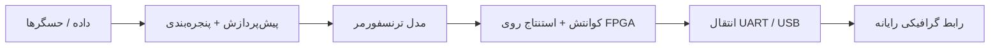

# فرم پیشنهاد پروژه کارشناسی

**دانشگاه صنعتی امیرکبیر (پلی‌تکنیک تهران)**  
**دانشکده مهندسی کامپیوتر**

## تحویل پیشنهاد پروژه به دانشکده و ثبت نهایی آن در پورتال

> این قسمت توسط کارشناسان آموزش دانشکده تکمیل می‌شود.

- تاریخ تحویل پیشنهاد پروژه به آموزش دانشکده: `........................................`
- تاریخ ثبت نهایی در پورتال آموزشی دانشگاه: `........................................`

## مشخصات دانشجو

- **نام و نام خانوادگی:** مهرداد شیخ عباسی
- **شماره دانشجویی:** 40131025
- **رایانامه (ایمیل) دانشجو:** m.sheikhabbasi@aut.ac.ir
- **نیمسال و سال تحصیلی ثبت‌نام پروژه:** نیمسال دوم از سال تحصیلی 1404-1405

### توضیحات اداری

1. دانشجو موظف است حداکثر دو ماه پس از ثبت‌نام پروژه، فرم تکمیل‌شده پیشنهاد پروژه را که به امضای استاد راهنمای او رسیده است، به آموزش دانشکده تحویل دهد. انجام به‌موقع این مرحله نشان‌دهنده بخشی از رعایت زمان‌بندی انجام پروژه توسط دانشجو است.

2. آموزش دانشکده پیشنهاد پروژه دریافتی را جهت تعیین داور و انجام داوری در اختیار گروه آموزشی استاد راهنمای دانشجو قرار می‌دهد. گروه‌های آموزشی حداکثر طی دو ماه داوری را انجام داده و در صورت تصویب در گروه، پیشنهاد پروژه را جهت تصویب در دانشکده و ثبت در پورتال آموزشی دانشگاه در اختیار آموزش دانشکده قرار می‌دهند. دانشجویان موظف‌اند با داور یا داوران پیشنهاد پروژه خود در ارتباط بوده و نظرات آنان را با راهنمایی استاد راهنمای خود و در مهلت مقرر گروه، روی پیشنهاد پروژه اعمال نمایند.

3. مهلت درج نمره پروژه دانشجویانی که در نیمسال اول یا در تابستان سال تحصیلی پروژه را اخذ نموده‌اند، سی‌ویک شهریور سال تحصیلی بعد و برای دانشجویانی که در نیمسال دوم پروژه را اخذ نموده‌اند، سی بهمن سال تحصیلی بعد است.

4. فاصله زمانی بین ثبت نهایی پیشنهاد پروژه تصویب‌شده در پورتال آموزشی دانشگاه و دفاع از پروژه حداقل دو ماه است و امکان دفاع پیش از سپری‌شدن این فاصله وجود ندارد. دفاع از پروژه کارشناسی با اعلان عمومی و با حضور مخاطبان و داوران انجام خواهد شد. لازم است دانشجویان حداقل یک هفته پیش از فرارسیدن مهلت درج نمره پروژه، پایان‌نامه تایپ‌شده خود را که به تأیید استاد راهنما رسیده است در اختیار آموزش دانشکده و داوران پروژه قرار داده و مقدمات برگزاری جلسه دفاع را با هماهنگی آموزش دانشکده فراهم آورند.

5. لازم است دانشجویان رویه دانشگاه صنعتی امیرکبیر با عنوان «چگونگی ثبت‌نام، تصویب، و دفاع از پایان‌نامه در مقطع کارشناسی» با شماره `AUT-PR-3210`، ویرایش دوم، را که روی سایت معاونت آموزشی دانشگاه قرار گرفته است مطالعه کنند.

### امضاها

- **تاریخ امضای دانشجو:** 1405/05/04
- **امضای دانشجو:** موجود در نسخه PDF
- **استاد راهنمای پروژه:** مرتضی صاحب‌الزمانی
- **امضای استاد راهنما:** موجود در نسخه PDF
- **تاریخ امضای استاد راهنما:** 1405/05/05

---

# عنوان پروژه

## عنوان فارسی

**طراحی و پیاده‌سازی سامانه پایش وضعیت بی‌درنگ ماشین‌آلات با استفاده از شبکه عصبی ترنسفورمر بر بستر FPGA**

## English Title

**Design and Implementation of a Real-Time Machinery Condition Monitoring System Using a Transformer Neural Network on FPGA**

## داوران پیشنهاد پروژه

### داور اول

- **نام و نام خانوادگی:** حمیدرضا زرندی
- **امضا:** موجود در نسخه PDF
- **تاریخ:** 1405/05/05

### داور دوم

- **نام و نام خانوادگی:** `........................................`
- **امضا:** `........................................`
- **تاریخ:** `........................................`

## تأیید داوران

با امضای این قسمت، داور یا داوران محترم تأیید می‌کنند که:

1. دانشجو با راهنمایی استاد راهنمای خود، اصلاحات مورد نظر داوران را انجام داده و عنوان و محتوای پیشنهاد پروژه از نظر ایشان قابل قبول است.
2. دانشجو با مفاهیم پیش‌نیاز و مهارت‌های ضروری و پایه انجام این پروژه آشنایی داشته یا کسب آن برای دانشجو در طول انجام پروژه امکان‌پذیر است.
3. موارد زیر در پیشنهاد پروژه مورد توجه قرار گرفته است:
   - عنوان پروژه به‌طور کامل و دقیق موضوع پروژه را نشان می‌دهد و محتوای پروژه با عنوان آن کاملاً مطابقت دارد.
   - پیشنهاد پروژه شامل بخش‌های مقدمه، مرور پیشینه پژوهش، رویکرد پیشنهادی، روش ارزیابی، مراحل و زمان‌بندی انجام پروژه، امکانات لازم و فهرست مراجع و منابع است.
   - اجزای سامانه مورد نظر پروژه در یک نمودار بلوکی نشان داده شده و ورودی‌ها و خروجی‌های آن مشخص شده‌اند.
   - تأکید پروژه روی مسائل عملی، علمی و مهارت‌های مهندسی کامپیوتر است و پروژه منجر به توسعه نرم‌افزار، سخت‌افزار یا ترکیبی از آن دو، با درجه سختی و حجم مناسب یک پروژه سه‌واحدی می‌شود.
   - پروژه بر مبنای استفاده از دروس کارشناسی تعریف شده است.
   - چنانچه قرار است در پروژه از ابزارها، نرم‌افزارها یا محیط‌های آماده استفاده شود، این موارد به‌صراحت بیان شده و مشخص شده است که کدام بخش‌ها و با چه میزان تلاش، سهم دانشجو هستند.
   - پروژه علاوه بر بخش مطالعاتی و نظری، حدود 150 ساعت کار عملی لازم داشته و انجام آن حداقل سه ماه زمان نیاز دارد.

## تصویب پیشنهاد پروژه

### تصویب در گروه آموزشی

- نام و نام خانوادگی مدیر گروه: `........................................`
- امضا: `........................................`
- تاریخ: `........................................`

### تصویب در شورای آموزشی-پژوهشی دانشکده

- نام و نام خانوادگی معاون آموزشی: `........................................`
- امضا: `........................................`
- تاریخ: `........................................`

---

# تعریف پروژه

## 1. مقدمه

### بیان مسئله کاربردی، ضرورت، انگیزه، اهداف و چالش‌های انجام پروژه

این پروژه با هدف طراحی و پیاده‌سازی یک سامانه پایش وضعیت و تشخیص خرابی برای ماشین‌آلات چرخان تعریف می‌شود. در این سامانه، ابتدا سیگنال‌های ارتعاشی و در صورت نیاز سایر سیگنال‌های مرتبط با وضعیت ماشین جمع‌آوری و پیش‌پردازش می‌شوند و سپس با استفاده از یک مدل مبتنی بر ترنسفورمر، نوع خرابی شناسایی می‌شود.

خروجی سامانه باید برای هر پنجره داده شامل کلاس خرابی و در صورت امکان میزان اطمینان مدل باشد. بنابراین، مسئله اصلی این پروژه از نوع طبقه‌بندی چندکلاسه است و هدف آن تعیین وضعیت و نوع خرابی ماشین برای هر پنجره داده است.

ضرورت انجام این پروژه از نیاز صنعت به پایش بی‌درنگ، کاهش توقف‌های ناخواسته، کاهش هزینه‌های نگهداری و تشخیص زودهنگام خرابی ناشی می‌شود. استفاده از ترنسفورمر در این مسئله به دلیل توانایی آن در مدل‌سازی وابستگی‌های زمانی در داده‌های چندکاناله اهمیت دارد، اما اجرای چنین مدلی روی FPGA با چالش‌هایی مانند محدودیت منابع، کاهش دقت عددی، زمان پاسخ و سادگی پیاده‌سازی همراه است.

هدف نهایی پروژه آن است که زنجیره نسبتاً کامل «از داده تا نتیجه» شامل آماده‌سازی داده، آموزش مدل، ساده‌سازی و کوانتش، استنتاج روی FPGA و نمایش خروجی روی رایانه شکل بگیرد.

## 2. مرور پروژه‌ها و سامانه‌های مشابه

در سال‌های اخیر برای تشخیص خرابی ماشین‌آلات از روش‌های مختلفی مانند روش‌های کلاسیک یادگیری ماشین، شبکه‌های `CNN`، `LSTM`، `GRU` و مدل‌های مبتنی بر توجه استفاده شده است [1]. در کارهای مبتنی بر مجموعه داده `MaFaulDa` نیز نتایج خوبی برای تشخیص خرابی‌های مربوط به عدم تعادل، ناهم‌محوری و خرابی یاتاقان گزارش شده است [1]، [3].

مطالعات جدیدتر نشان می‌دهند که مدل‌های ترنسفورمر برای داده‌های زمانی چندمتغیره در حوزه تشخیص خرابی عملکرد بسیار مناسبی دارند، زیرا می‌توانند الگوهای زمانی و روابط بین کانال‌ها را به‌صورت مؤثرتری استخراج کنند [4]، [5]. با این حال، بسیاری از این کارها صرفاً در محیط نرم‌افزار باقی می‌مانند و به جنبه‌های استقرار روی سخت‌افزار، محدودیت منابع و ارتباط با سامانه واقعی کمتر می‌پردازند [1]، [4]، [5].

یکی از کارهای مرتبط داخلی، پایان‌نامه کارشناسی ارشد آدینه‌پور [6] با عنوان «شتاب‌دهی سخت‌افزاری پیش‌بینی عمر باقی‌مانده مفید دستگاه‌های دوار با استفاده از شبکه عصبی ترنسفورمر بر بستر FPGA» است. در این پایان‌نامه، یک مدل مبتنی بر ترنسفورمر برای پیش‌بینی عمر مفید باقی‌مانده تجهیزات دوار طراحی و مرحله استنتاج آن روی FPGA پیاده‌سازی شده است. مسئله آن پژوهش از نوع رگرسیون است و خروجی مدل، یک مقدار پیوسته به‌عنوان عمر مفید باقی‌مانده یا `RUL` است. مجموعه داده اصلی مورد استفاده در آن کار نیز `XJTU-SY` است که شامل داده‌های ارتعاشی مربوط به روند تخریب بلبرینگ‌ها تا رسیدن به خرابی است.

در مقابل، مسئله پروژه حاضر تشخیص و تفکیک نوع خرابی به‌صورت طبقه‌بندی چندکلاسه است. داده‌های اصلی این پروژه از مجموعه داده `MaFaulDa` تأمین می‌شوند و خروجی مدل، به‌جای یک مقدار پیوسته، یک برچسب گسسته مانند سالم، عدم تعادل، ناهم‌محوری یا خرابی یاتاقان است.

بنابراین، کار [6] به پرسش «چه مقدار از عمر مفید دستگاه باقی مانده است؟» پاسخ می‌دهد، در حالی که پروژه حاضر به پرسش «دستگاه اکنون در چه وضعیت و با چه نوع خرابی کار می‌کند؟» می‌پردازد. خروجی تعریف‌شده در کار [6] نوع خرابی را مشخص نمی‌کند و به همین دلیل، انجام پروژه حاضر برای تشخیص نوع عیب و فراهم‌کردن اطلاعات مناسب جهت انتخاب اقدام نگهداری همچنان ضروری است. این دو مسئله در سامانه‌های پایش سلامت تجهیزات، متفاوت و در عین حال مکمل یکدیگرند.

مقایسه پروژه حاضر با کار [6] از نظر نوع مسئله، مجموعه داده، شیوه برچسب‌گذاری، نوع خروجی، معیارهای ارزیابی و ساختار کلی پیاده‌سازی سخت‌افزاری انجام می‌شود. با توجه به اینکه یکی از مسائل از نوع رگرسیون و دیگری از نوع طبقه‌بندی است، مقایسه مستقیم معیارهای دقت دو مدل معنادار نیست.

نقطه قوت پروژه حاضر این است که برای مسئله تشخیص نوع خرابی، تنها به آموزش مدل اکتفا نمی‌کند، بلکه مسیر کامل از تحلیل داده تا پیاده‌سازی عملی را دنبال می‌کند. بنابراین، خروجی پروژه علاوه بر ارزش پژوهشی، ارزش مهندسی کاربردی نیز خواهد داشت.

### مرور خلاصه سامانه‌های مشابه

1. سامانه‌های نرم‌افزاری تشخیص خرابی مبتنی بر `MaFaulDa` که عمدتاً روی رایانه اجرا می‌شوند [1]، [3].
2. پژوهش‌های مبتنی بر `GRU`، `LSTM` و `CNN` برای پایش وضعیت ماشین‌آلات دوار [1].
3. پژوهش‌های جدید مبتنی بر ترنسفورمر و توجه برای تشخیص خرابی [4]، [5].
4. سامانه‌های نهفته‌ای که نیازمند ساده‌سازی مدل و استنتاج سبک برای استقرار روی سخت‌افزار هستند [7].
5. سامانه پیش‌بینی عمر مفید باقی‌مانده تجهیزات دوار مبتنی بر ترنسفورمر و FPGA که مسئله‌ای از نوع رگرسیون را حل می‌کند [6].

## 3. روش انجام پروژه

روش انجام پروژه به‌صورت مرحله‌ای و از سطح نرم‌افزار تا سخت‌افزار خواهد بود. در فاز نخست، مجموعه داده `MaFaulDa` بررسی و فایل‌ها در سطح فایل برچسب‌گذاری، پاک‌سازی و برای پنجره‌بندی آماده می‌شوند. سپس از هر نمونه خام، پنجره‌های زمانی با طول مناسب استخراج شده و مدل ترنسفورمر پایه در محیط پایتون آموزش داده می‌شود.

پس از ارزیابی، نسخه‌ای سبک‌تر از مدل با تعداد لایه‌ها و ابعاد مناسب انتخاب شده و برای استقرار روی FPGA کوانتیزه یا به نمایش عددی محدود تبدیل می‌شود.

در ادامه، مسیر استنتاج روی FPGA شامل بافر ورودی، هسته پردازش، منطق تصمیم‌گیری و ارسال نتیجه به رایانه طراحی می‌شود. در صورت امکان، داده می‌تواند از حسگر یا یک منبع آزمایشگاهی نیز به سامانه وارد شود، اما حداقل خروجی باید برای داده‌های آماده‌شده و پنجره‌های تعریف‌شده قابل نمایش و ارزیابی باشد.

### مراحل پیاده‌سازی

1. تحلیل مجموعه داده و استانداردسازی ورودی‌ها.
2. پیش‌پردازش، نرمال‌سازی و پنجره‌بندی سیگنال‌ها.
3. آموزش و ارزیابی مدل پایه ترنسفورمر در محیط پایتون.
4. انتخاب نسخه سبک‌تر مدل و اعمال ساده‌سازی‌هایی مانند کاهش تعداد لایه‌ها، کاهش ابعاد لایه‌های پنهان و تجمیع مناسب.
5. کوانتش و تبدیل مدل به نمایش عددی مناسب برای سخت‌افزار.
6. طراحی مسیر استنتاج روی FPGA و منطق تبادل داده.
7. ارسال نتیجه به رایانه و نمایش خروجی در رابط کاربری.

### ورودی‌ها و خروجی‌ها

ورودی‌های سامانه شامل پنجره‌های زمانی چندکاناله از سیگنال‌های مربوط به وضعیت ماشین است که می‌تواند از مجموعه داده `MaFaulDa` یا از مسیر دریافت داده از حسگر یا منبع آزمایشگاهی تأمین شود.

خروجی سامانه شامل برچسب کلاس خرابی برای هر پنجره، مانند سالم، عدم تعادل، ناهم‌محوری و خرابی یاتاقان، و در صورت امکان امتیاز اطمینان مدل است. این نتیجه باید از FPGA به رایانه منتقل شده و در یک رابط ساده کاربر نمایش داده شود.

### نمودار بلوکی پیشنهادی سامانه

## 4. روش ارزیابی

ارزیابی پروژه در دو سطح نرم‌افزاری و سخت‌افزاری انجام می‌شود. در بخش نرم‌افزاری، کیفیت مدل با استفاده از داده‌های آموزش، اعتبارسنجی و آزمون مستقل بررسی می‌شود و در بخش سخت‌افزاری، قابلیت اجرای مدل با منابع موجود FPGA و زمان پاسخ سامانه سنجیده خواهد شد.

### ارزیابی فنی

1. **معیارهای یادگیری ماشین:** دقت، صحت، بازخوانی، امتیاز `F1`، ماتریس درهم‌ریختگی و در صورت امکان `ROC/AUC`.
2. **ارزیابی تعمیم‌پذیری:** استفاده از تفکیک در سطح فایل، جلوگیری از نشت داده و بررسی عملکرد روی داده‌های دیده‌نشده.
3. **ارزیابی سخت‌افزاری:** بررسی مصرف منابع FPGA شامل `LUT`، `FF`، `BRAM` و `DSP`، همچنین تأخیر و نرخ گذردهی.
4. **ارزیابی سامانه:** صحت تبادل داده بین FPGA و رایانه، پایداری ارسال نتیجه و نمایش درست خروجی در رابط کاربری.

## 5. مراحل انجام و زمان‌بندی پروژه

زمان‌بندی پیشنهادی زیر بر مبنای شش بازه دوماهه تنظیم شده است.

| مرحله | عنوان فعالیت | بازه 1 | بازه 2 | بازه 3 | بازه 4 | بازه 5 | بازه 6 |
|---:|---|:---:|:---:|:---:|:---:|:---:|:---:|
| 1 | مرور منابع و نهایی‌سازی مشخصات فنی پروژه | ● | ● |  |  |  |  |
| 2 | آماده‌سازی داده، پیش‌پردازش و پنجره‌بندی |  | ● | ● |  |  |  |
| 3 | آموزش و ارزیابی مدل پایه ترنسفورمر |  |  | ● | ● |  |  |
| 4 | ساده‌سازی مدل، کوانتش و آماده‌سازی برای FPGA |  |  |  | ● | ● |  |
| 5 | طراحی و پیاده‌سازی بخش سخت‌افزاری و ارتباط با رایانه |  |  |  |  | ● | ● |
| 6 | آزمون نهایی، تحلیل نتایج و آماده‌سازی گزارش |  |  |  |  |  | ● |

## 6. امکانات لازم

امکانات لازم برای انجام پروژه شامل موارد زیر است:

- رایانه مناسب برای آموزش و آزمون مدل.
- محیط پایتون و کتابخانه‌هایی مانند:
  - `PyTorch`
  - `NumPy`
  - `pandas`
  - `Matplotlib`
  - `scikit-learn`
- نرم‌افزار `Vivado` برای طراحی و سنتز بخش سخت‌افزاری.
- برد FPGA مناسب.
- کابل و مبدل ارتباطی `USB/UART`.
- در صورت امکان، حسگر شتاب‌سنج یا مجموعه آزمایشگاهی ساده برای ورود داده واقعی.

بخش‌های آماده مورد استفاده صرفاً شامل کتابخانه‌های عمومی پردازش داده، آموزش مدل و ابزارهای توسعه FPGA است. تحلیل مسئله، طراحی خط لوله داده، انتخاب و تنظیم معماری مدل، کوانتش، طراحی مسیر سخت‌افزاری، آزمون سامانه و مستندسازی علمی همگی جزء سهم مستقیم دانشجو محسوب می‌شوند.

## 7. مراجع و منابع

[1] A. Koutoulas, “Fault Detection in Industrial Machinery,” 2024.

[2] MaFaulDa, “Machinery Fault Database,” [Online]. Available:  
https://www.kaggle.com/datasets/vuxuancu/mafaulda-full  
[Accessed 24 April 2026].

[3] T. Spadini, K. Nose-Filho and R. Suyama, “Intelligent Fault Diagnosis of Type and Severity in Low-Frequency, Low Bit-Depth Signals,” Cornell University, Ithaca, 2024.

[4] Y. Jin, L. Hou and Y. Chen, “A New Rotating Machinery Fault Diagnosis Method Based on the Time Series Transformer,” Cornell University, Ithaca, 2021.

[5] E. G. S. Nascimento, J. S. Liang, I. S. Figueiredo and L. L. N. Guarieiro, “T4PdM: a Deep Neural Network based on the Transformer Architecture for Fault Diagnosis of Rotating Machinery,” SSRN Electronic Journal, 2022.

[6] ر. آدینه‌پور، «شتاب‌دهی سخت‌افزاری پیش‌بینی عمر باقی‌مانده مفید دستگاه‌های دوار با استفاده از شبکه عصبی ترنسفورمر بر بستر FPGA»، پایان‌نامه کارشناسی ارشد، دانشکده مهندسی کامپیوتر، دانشگاه صنعتی امیرکبیر، تهران، 1405.

[7] T. Ling, C. Qian and G. Schiele, “Integer-only Quantized Transformers for Embedded FPGA-based Time-series Forecasting in AIoT,” 2024.

---

## معادل اصطلاحات پاورقی

- Transformer: ترنسفورمر
- Attention: توجه
- Fault Diagnosis: تشخیص خرابی
- Python: پایتون
- Hidden: پنهان
- Pooling: تجمیع
- Pipeline: خط لوله
